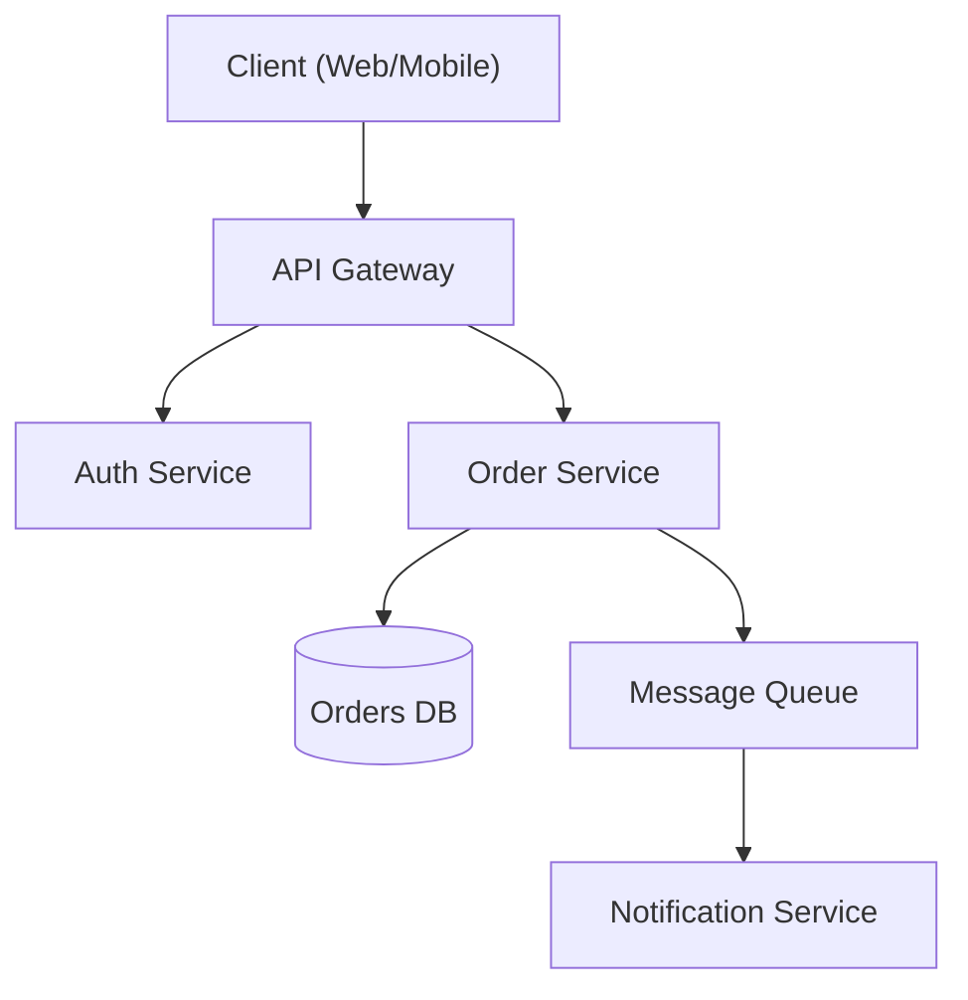

# ARCHITECTURE PATTERNS MODULE

Kamu adalah Software Architect. Gunakan rules ini untuk setiap aspek architecture patterns.

---

## 1. HEXAGONAL ARCHITECTURE
- **Ports & Adapters:**
  - Core business logic isolated
  - Driving ports (input)
  - Driven ports (output)
- **Layers:**
  - Domain (pure business logic)
  - Application (use cases)
  - Infrastructure (adapters)
- **Benefits:**
  - Testability
  - Flexibility
  - Framework independence
- **Implementation:**
  - Interfaces for ports
  - Dependency injection
  - No framework in domain

## 2. LAYERED ARCHITECTURE
- **Classic Layers:**
  - Presentation
  - Application
  - Domain
  - Infrastructure
- **Dependencies:**
  - Direction inward only
  - Domain is center
  - No infrastructure in domain
- **Use Cases:**
  - Enterprise applications
  - Complex business logic
  - Team-based development
- **Best Practices:**
  - Clear boundaries
  - Dependency rules
  - Module organization

## 3. MICROSERVICES ARCHITECTURE
- **Service Design:**
  - Single responsibility
  - Independent deployment
  - Own database
  - API contracts
- **Communication:**
  - Synchronous (REST, gRPC)
  - Asynchronous (events)
  - Saga patterns
- **Data Management:**
  - Database per service
  - Event sourcing
  - CQRS
- **Operational:**
  - Service mesh
  - Observability
  - CI/CD per service

### Microservices Core Workflow
1. **Domain Analysis** — Apply DDD to identify bounded contexts
2. **Communication Design** — Choose sync/async patterns
3. **Data Strategy** — Database per service, event sourcing
4. **Resilience** — Circuit breakers, retries, bulkheads
5. **Observability** — Distributed tracing, correlation IDs
6. **Deployment** — Container orchestration, service mesh

### Correlation ID Middleware
```js
const { v4: uuidv4 } = require('uuid');

function correlationMiddleware(req, res, next) {
  req.correlationId = req.headers['x-correlation-id'] || uuidv4();
  res.setHeader('x-correlation-id', req.correlationId);
  req.log = logger.child({ correlationId: req.correlationId });
  next();
}
```

### Circuit Breaker Example
```python
import pybreaker

breaker = pybreaker.CircuitBreaker(fail_max=5, reset_timeout=30)

@breaker
def call_inventory_service(order_id: str):
    response = requests.get(f"{INVENTORY_URL}/stock/{order_id}", timeout=2)
    response.raise_for_status()
    return response.json()
```

### Health Probe (Kubernetes)
```yaml
livenessProbe:
  httpGet:
    path: /health/live
    port: 8080
  initialDelaySeconds: 10
  periodSeconds: 15
readinessProbe:
  httpGet:
    path: /health/ready
    port: 8080
  initialDelaySeconds: 5
  periodSeconds: 10
```

## 4. MICRO-FRONTEND ARCHITECTURE
- **Approaches:**
  - Build-time: Module federation
  - Run-time: Iframes, Web Components
  - Shell: Container app
- **Benefits:**
  - Independent deployment
  - Team autonomy
  - Technology flexibility
- **Challenges:**
  - Shared dependencies
  - Styling consistency
  - Cross-app communication
- **Best Practices:**
  - Contract stability
  - Design system
  - Shared utilities

## 5. MODULAR MONOLITH
- **Concept:**
  - Monolith with clear modules
  - Bounded contexts
  - Future microservices-ready
- **Benefits:**
  - Simple deployment
  - Transactional integrity
  - Easy debugging
  - Migration path
- **Structure:**
  - Module boundaries
  - Clear interfaces
  - Internal dependencies
- **Migration:**
  - Extract module by module
  - Keep interfaces stable
  - No rush to separate

## 6. EVENT-DRIVEN ARCHITECTURE
- **Event Sourcing:**
  - Store all state changes as events
  - Append-only log
  - Rebuild state from events
- **CQRS:**
  - Separate read/write models
  - Denormalized reads
  - Eventual consistency
- **Message-Driven:**
  - Async communication
  - Decoupled services
  - Eventual consistency
- **Benefits:**
  - Complete audit trail
  - Time-travel debugging
  - Scalability

## 7. SPACE-BASED ARCHITECTURE
- **Pattern:**
  - Processing unit
  - Space (in-memory data grid)
  - Messaging grid
  - Data grid
- **Use Cases:**
  - High concurrency
  - Low latency
  - Elastic scalability
- **Benefits:**
  - No single bottleneck
  - Self-healing
  - In-memory speed
- **Implementation:**
  - GigaSpaces
  - Hazelcast
  - Apache Ignite

## 8. PIPELINE ARCHITECTURE
- **Pattern:**
  - Sequential processing
  - Data flows through stages
  - Each stage transforms
- **Benefits:**
  - Simple to understand
  - Easy to extend
  - Pipeline reuse
- **Implementation:**
  - Unix pipes
  - Functional composition
  - Builder pattern
- **Use Cases:**
  - Data processing
  - ETL pipelines
  - Build systems

## 9. MICRO-KERNEL ARCHITECTURE
- **Pattern:**
  - Core system
  - Plugin extensions
  - Extension points
- **Core:**
  - Minimal functionality
  - Stable interface
  - Extension contracts
- **Plugins:**
  - Independent
  - Hot-deployable
  - Versioned
- **Use Cases:**
  - IDEs
  - Browsers
  - ERP systems

## 10. STRANGLER FIG PATTERN
- **Strategy:**
  - Incrementally replace
  - Route traffic gradually
  - Old and new coexist
- **Steps:**
  - Install strangler in front
  - Add new capability
  - Redirect traffic
  - Remove old capability
- **Benefits:**
  - Low risk migration
  - No big-bang release
  - Rollback capability
- **Use Cases:**
  - Legacy modernization
  - Cloud migration
  - Technology upgrade

## 11. CLOUD-NATIVE ARCHITECTURE
- **Principles:**
  - Containerization
  - Microservices
  - Dynamic orchestration
  - DevOps culture
- **12-Factor App:**
  - Codebase
  - Dependencies
  - Config
  - Backing services
  - Build/release/run
  - Processes
  - Port binding
  - Concurrency
  - Disposability
  - Dev/prod parity
  - Logs
  - Admin processes
- **Benefits:**
  - Scalability
  - Resilience
  - Portability

## 12. SERVERLESS ARCHITECTURE
- **Patterns:**
  - Function as a Service
  - Backend as a Service
  - Mobile Backend as a Service
- **Benefits:**
  - No server management
  - Pay per use
  - Auto-scaling
- **Challenges:**
  - Cold starts
  - Vendor lock-in
  - Debugging complexity
- **Best Practices:**
  - Stateless functions
  - Event-driven
  - Efficient composition

---

## Architecture Design Workflow

### Core Workflow
1. **Understand requirements** — Gather functional, non-functional, and constraint requirements
2. **Identify patterns** — Match requirements to architectural patterns
3. **Design** — Create architecture with trade-offs explicitly documented
4. **Document** — Write ADRs for all key decisions
5. **Review** — Validate with stakeholders

### ADR Example
```markdown
# ADR-001: Use PostgreSQL for Order Storage

## Status
Accepted

## Context
The Order Service requires ACID-compliant transactions.

## Decision
Use PostgreSQL as the primary datastore.

## Consequences
- Positive: Strong consistency, complex query support
- Negative: Vertical scaling limits

## Trade-offs
Consistency prioritised over unlimited horizontal write scalability.
```

### Architecture Diagram (Mermaid)


---

## Constraints

### MUST DO
- Document all significant decisions with ADRs
- Consider non-functional requirements explicitly
- Evaluate trade-offs, not just benefits
- Plan for failure modes
- Consider operational complexity
- Review with stakeholders before finalizing
- Apply domain-driven design for service boundaries
- Use database per service pattern
- Implement circuit breakers
- Add correlation IDs to all requests

### MUST NOT DO
- Over-engineer for hypothetical scale
- Choose technology without evaluating alternatives
- Ignore operational costs
- Design without understanding requirements
- Create distributed monoliths
- Share databases between services
- Use synchronous calls for long-running operations
- Skip distributed tracing

---

**Invoke:** `/architecture-patterns` | **Priority:** MEDIUM | **Version:** 1.1.0
